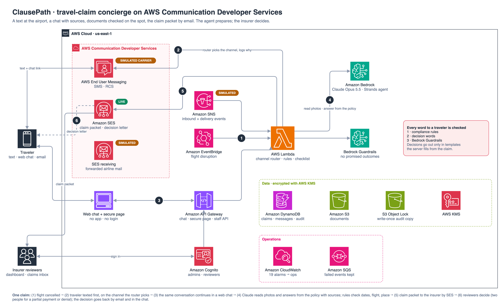

# ClausePath

**An AI claims concierge for travel insurers — answers with the clause behind them.**
A text reaches the stranded traveler, the same conversation continues in a web chat, and the finished claim reaches
the insurer by email. Built on AWS Communication Developer Services and Amazon Bedrock.

**Demo video (3 min):** https://youtu.be/h68LbldHlqU

[](https://youtu.be/h68LbldHlqU)

## The problem

When a typhoon cancels a flight, travelers have one question and nobody to ask: *is my hotel covered, and what do I
need to keep?* The documents that decide a claim — the airline's cancellation letter, itemised receipts — must be
collected **on the spot**. Most people find out what was needed only at home, then lose days or weeks going back and
forth with the insurer.

## What it does

1. **One report reaches every covered traveler.** The insurer reports a disrupted flight once (dashboard or an
   EventBridge event). ClausePath finds everyone on that flight whose plan covers delays and sends each a
   **proactive message** with a link to their own claim chat. A router picks the channel per person and logs why.
2. **One conversation across channels.** Travelers can text back and get an answer by text. The link opens the
   **same conversation as a web chat** — no app, no login.
3. **Answers with proof.** The agent (Claude on Amazon Bedrock) answers coverage questions from the policy wording
   and cites it. Tapping a citation highlights the exact clause on the original PDF page; the **clause map** shows how
   it connects to the plan's limits and exclusions.
4. **Documents checked as they arrive.** Photos of letters, boarding passes and receipts are read by Claude, then
   checked by **deterministic rules** (dates and delay window, flight, place, covered categories, limits, FX,
   airline-paid costs, duplicates). A blurry photo gets a retake request at once; excluded items (e.g. minibar,
   clause TD-4) are left out with the clause shown.
5. **Sensitive data stays off chat.** The claim form, ID and bank details go only through a **secure page**.
6. **The insurer decides.** The claim packet goes to the insurer by **Amazon SES** with all originals. Reviewers decide
   on a dashboard; denials, partial payments and larger payouts need a second reviewer. The decision reaches the
   traveler **by email first, then in the chat**, where they can object.
7. **No promises it can't keep.** Every free-text message — the agent's and the staff's — passes three wording
   checks, including **Amazon Bedrock Guardrails**. Decisions go out only as **templates filled from the claim**.

The agent prepares the claim. The insurer decides.

## What is live and what is simulated

| | In the product | In the demo |
| --- | --- | --- |
| **Email** — Amazon SES | Packets, copies, decision letters | **Live** (SES sandbox, verified address) |
| **SMS / RCS** — AWS End User Messaging | Alerts, two-way replies, fallback | **Simulated carrier**: no sending number could be registered within the hackathon |
| **WhatsApp** — End User Messaging Social | Templates and session messages | Code and tests only (not in the video) |
| **AI** — Claude on Amazon Bedrock, Bedrock Guardrails | Agent, extraction, wording checks | **Live** |

**Phone simulator** (demo only, `SIM_PHONE=on`). To show the SMS/RCS side honestly without a carrier, SMS and RCS
sends go to an on-screen phone (`channels/simphone.py`, provider ids `sim-…`). The router, the messages and the logged
reasons are the real ones. Admins open it from **Operations → Phone simulator**: it has SMS, Web and Mail tabs, sends
replies back as inbound SMS/RCS through the same path a carrier event takes, and says on screen that delivery is
simulated. Demo personas get fictional numbers (+1 202 555-01xx) only while the simulator is on.

Without channel identities the stack still runs end to end and records each such send as undelivered, with the reason.



## How AWS CDS is used

| Service and SDK call | Code | What it does | Demo |
| --- | --- | --- | --- |
| Amazon SES — `sesv2.send_email` (raw MIME with attachments) | `channels/live.py`, `service.submit_claim` | Claim packet to the insurer; copy, decision letter and status mail to the traveler | **Live** |
| AWS End User Messaging — `pinpoint-sms-voice-v2.send_rcs_message`, `send_text_message` | `channels/live.py` | RCS with server-side SMS fallback | Simulated |
| AWS End User Messaging Social — `socialmessaging.send_whatsapp_message`, `get_whatsapp_message_media` | `channels/live.py` | Approved templates outside the 24-hour window, session messages inside it, receipt photos in | Code and tests |
| SES receiving → S3 → Lambda | `handlers/ses_inbound.py`, `inbound.parse_email` | Travelers forward the airline's email; body and attachments become documents | Simulated |
| SNS event destinations | `handlers/inbound_sns.py`, `inbound.parse_sns_message` | Inbound messages, statuses and delivery events | Simulated |

**Channel choice** (`router.py`). Each message picks a channel from consent, the channel the traveler is using, their
preference, WhatsApp's 24-hour session window, recent delivery failures and what the message carries (photo requests
prefer WhatsApp/RCS; packets and formal notices go by email). A delivery failure re-sends on the next channel. Every
outbound message stores its reason — e.g. `whatsapp reported undelivered (Message undeliverable) -> fallback order` —
and the dashboard shows it.

## How the agent works

**Engine.** Strands Agents on Amazon Bedrock (Claude Opus 5.5), deployable on Amazon Bedrock AgentCore Runtime
(`handlers/agentcore_app.py`, `Dockerfile.agentcore`) or in-process in Lambda. Tools: `assess_coverage` (structured
policy reading with clause citations), `search_documents`, `show_evidence`, `secure_link`, `submit_claim`. Facts reach
the agent through a CONTEXT block built by code — extracted fields, failed checks, the checklist — so it cannot
invent them.

**Answers with numbered sources (RAG).** `search_documents` retrieves clauses from the sample policy and FAQ PDFs
(Titan Text Embeddings v2, keyword fallback; index built by `policy/build_index.py`). The agent attaches up to three
passages with `show_evidence`; the reply cites [1], [2], and a source card highlights each passage on the original PDF
page. Page images use versioned, immutable URLs, so each page downloads once per device.

**Clause map.** `web/docs/ontology.json` types how clauses depend on each other (requires, limit, defined by, excludes,
extends, claim step …); explicit [ID] mentions and FAQ answers add more links. From a source card, the map opens an
animated graph centred on the passage; tapping a clause follows the link and shows its highlight.

**Live agent trail.** While the agent works, the chat shows each step as it happens — photos read, policy searched,
plan and dates checked, sources highlighted — and keeps it folded under the reply ("Checked 5 steps"). Photos the
traveler sent come back as thumbnails, marked when one needs a retake or a check.

**Rules over judgement.** Extraction and coverage are single structured calls (Bedrock Converse with JSON-schema
output). Anything that can be a rule is a rule (`validate.py`, `checklist.py`), so a reviewer can re-check every flag
by hand. Bank and ID details are refused in chat, ID photos are detected and not stored, slow steps send a "checking
your policy" message first, and inbound messages are de-duplicated.

**Demo personas** (Operations → Demo personas). The same typhoon cancellation for seven travelers: Plus, Premier,
Basic (no delay cover, PLAN-1), bought after the typhoon warning (EX-1), trip extended past the policy period (EX-3),
cancelled on the last day of cover (automatic extension, TD-6), and an English traveler. Asked about tonight's hotel,
each gets a different answer with different sources.

### English and Korean

- Every traveler has a language (`en` or `ko`), set at enrolment, following the language they write in, and fixed
  once they ask for one ("English", "한국어").
- The agent writes in that language; templates, reminders, email subjects and the secure page come from `i18n.py`.
- Reviewers switch the dashboard between EN and 한국어; `REVIEW_LOCALE` sets the language of the claim packet.
- Airline documents carry the romanised passport name, so travelers keep a `passport_name` (e.g. `KIM/JISOO MS`).
  If only a Hangul name is on file, letters are flagged *name not verified* instead of passing silently.
- In the chat, a 한국어 / English switch changes the page, the texts and the agent's language for that traveler.
- `python -m tripclaim.sim --lang ko` plays the whole storyline as a Korean traveler.

## What free text may say to a traveler

An insurer cannot let a chatbot sound like a promise. Free text — the agent's replies and staff messages — is checked
sentence by sentence before it is sent:

1. **Compliance regex** (`prompts/banned_wording.txt`): promised outcomes, dates and amounts. Instant, free, exact.
2. **Decision words**: free text never states the claim's decision (approved, paid, denied, the amount granted). The
   decision reaches the traveler only through **templates the server fills from the claim** — the decision notice
   and letter, and the contact centre's "why less" / "pay date" replies.
3. **Amazon Bedrock Guardrails** (`ApplyGuardrail`), two denied topics, Standard tier (Korean):
   "OutcomePromise" (`prompts/promise_topic.json`) and "DecisionStatement" (`prompts/decision_topic.json`).

Staff text that fails is refused (HTTP 422). In the agent's replies, the offending sentence is replaced with a neutral
line. Every blocked attempt is in the audit log and on the KPI screen, by person.

**Measured** on the deployed guardrail (`eval/guardrail/pipeline_eval.py`, results in
`eval/guardrail/pipeline-results-v3.md`): 183 of 188 sentences that must be blocked are blocked, 78 of 80 careful
sentences pass. Cost: about $0.15 per 1,000 text units.

**Known limits.** Some paraphrases pass ("Your claim's a yes"). If the guardrail cannot be reached, the first two
checks decide alone, an alarm fires (`GUARDRAIL_ERROR`) and each message is logged as `guardrail_skipped` for
re-checking.

## The staff desk

Dashboard with Cognito groups **admins**, **reviewers** and **agents** (contact centre).

**Decisions.** Reviewers decide full (the estimate), partial (less, with clauses and a note) or deny (clauses and a
note). The traveler is told why and how to object within 30 days.

**Four eyes.** A second reviewer must confirm before the traveler hears the decision when it is a denial, a partial
payment (`DUAL_FOR_PARTIAL`, on by default), at least `DUAL_APPROVAL_OVER_USD` ($300 by default; the demo stack sets
$100), or past open checks. A bulk SMS to more than `BULK_SECOND_ADMIN_OVER` (100) recipients waits for a second admin.

**Contact centre.** Send a message, resend the chat link, or ask for the bank account again. Identity checks are
ticked boxes (at least two for bank or contact changes) and go to the audit trail. Until the traveler enters a new
account on a bank-only secure page, the old one is void. Owner and hand-off (to whom, what, by when) with a "mine /
handed to me" filter.

**Objections.** The traveler objects from the decision card, or an agent records one taken on the phone. A reviewer
who did not make the decision either keeps it, with a reason (the traveler is told about FSS dispute mediation,
1332 / www.fcsc.kr), or corrects it. A printable decision letter is at `/c/{token}/decision`.

**Operations controls.**

- **Preview before every bulk send**: recipients, the channel each gets, SMS parts (Hangul = 70 characters a part),
  estimated cost and the exact text in each language.
- **Audit log (admins)**: every opened claim, original photo viewed, decision, contact-centre action, bulk send and
  traveler submission, with filters and CSV export.
- **Write-once audit copy**: every entry also goes to an S3 bucket with **Object Lock** (governance mode, `-c audit_days`,
  default 30). The bucket survives stack deletion; the Lambdas can only put objects there. Viewing and exporting the
  log are themselves audited.
- **KPIs (admins)**: per disruption — claims, chats opened, submitted, decided, open checks, hours to submit and to
  decide — plus cited replies, reviewer changes, retakes, SMS cost, AI errors and blocked wording.
- **Alarms** (SNS topic OpsAlarms, `-c alarm_email=…`): audit copy failed, AI errors, wording found after sending,
  text-message failures and overdue objections.
- **Original photos**: fetched with the staff token, logged on each view, shown side by side with another claim's copy
  when a photo was reused.
- **Submitting by text**: replying SUBMIT returns a summary; only YES within 30 minutes files the claim.
- **Expected dates** follow clause CL-4: `PAY_BUSINESS_DAYS` (3) or `REVIEW_BUSINESS_DAYS` (10) when something needs a
  check. `DUE_DATES=off` hides them, e.g. during a mass event.
- **Local demo users** (no Cognito): admin@demo, reviewer-1/2/3@demo and agent@demo, picked in the dashboard header.
- **Production profile**: `-c profile=prod` keeps data on stack deletion and holds the audit copy for 5 years in
  compliance mode. `-c retain=true` keeps the table, documents bucket and user pool.

## Evaluation

| What | Set | Result |
| --- | --- | --- |
| Coverage guidance | 18 scenarios incl. exclusions, limits, airline-paid costs, bank details in chat | status 18/18; wrongly told "not covered" 0; required clauses cited 100%; replies ≤ 60 words |
| Extraction + rule checks | 18 synthetic documents, 15 claim bundles with planted errors | fields 121/121; planted errors caught 13/13; false flags 0 |
| **Real Japanese receipts, full set** | all 1,148 unique photos of JaWildText `receipt_kie` (1,146 with a total label) | **total 1,143/1,146 (99.7%)**, date 98%, time 99% |
| Real Japanese receipts, sample | 120 of the same photos | total 119/120, date 116/120, time 116/118 |

Of the three total misses in the full set, two read the amount actually paid (after points or rounding) where the label
holds the pre-discount total; one is a misread digit (¥2,815 for ¥2,819). Synthetic sets were written by the team, so
they are optimistic; the real-receipt runs are the independent check.

Run: `python eval/runners/run_coverage.py`, `run_extract.py --data data/synth_v1`, `run_extract_real.py --data data/jawildtext`
(`eval/tools/fetch_jawildtext.py` downloads the receipts; the images are not redistributed here).

## Testing instructions for judges

Dashboard: https://19ui9qognk.execute-api.us-east-1.amazonaws.com/

Judge logins (demo data only; **valid until 2026-11-19**, then disabled and the deployment taken down):

| Role | ID | Password |
| --- | --- | --- |
| Admin and first reviewer | `judge@clausepath.example` | `Judge-oIH1bveAGPMK1!` |
| Second reviewer (open in a private window) | `judge2@clausepath.example` | `Judge-lvNep2t-eR602!` |

Problems signing in: bgkim@megazone.com. No login needed to try it offline: `python -m tripclaim.sim --serve 8080` runs
the full storyline locally without an AWS account (see [Run it locally](#run-it-locally-no-aws-messaging-needed)).

1. Sign in as the admin. If a previous session left claims behind, use **Operations → Reset demo data**.
2. **Operations → Demo personas** creates seven demo travelers on flight XX123 (fictional people and numbers).
3. In **Operations**, report the disruption: flight `XX123`, today's date, `cancelled` → **Preview** → confirm.
4. **Operations → Phone simulator** opens a phone; pick Jordan Taylor. The alert arrives in the **SMS** tab; reply by text.
5. Tap the link in the text: the **Web** tab opens the same conversation. Ask about tonight's hotel, tap a citation,
   then the clause map.
6. Send photos with **Photo** (`python demo/make_assets.py --date <yesterday>` generates a matching set), fill in the
   secure page, and submit.
7. On the dashboard, decide the claim. Amounts over $100 need a second reviewer: confirm as the second login in a
   private window. The decision arrives in the phone's **Mail** tab and in the chat.
8. In the claim's message box, type "Good news, your hotel was approved." and send it: it is blocked.

Offline: `python -m tripclaim.sim` reproduces the full storyline; `demo/out/packet.html` is the packet the insurer receives.

## Run it locally (no AWS messaging needed)

```bash
uv venv --python 3.13 .venv && uv pip install --python .venv/bin/python -e ".[dev,infra,local]" pillow
.venv/bin/python -m pytest                       # flow, router, inbound parsing, API, Korean mode, web chat
.venv/bin/python demo/make_assets.py             # synthetic letter, receipts, boarding pass, airline email
PYTHONPATH=src .venv/bin/python -m tripclaim.sim --serve 8080   # full storyline, then the dashboard
```

The simulator plays the demo end to end with in-memory storage and fake channels, but **real model calls**. Locally
the agent runs on the **Claude Agent SDK** with your own Claude login (`LLM_BACKEND=sdk`): the same system prompt,
tools and output schemas as on AWS, without Bedrock calls (policy search falls back to keyword ranking).
`--llm bedrock` runs it exactly as deployed. Deployed, the model is Bedrock only: the SDK is not in the Lambda
packages and refuses to run there.

DynamoDB integration: `docker run -d -p 8000:8000 amazon/dynamodb-local -jar DynamoDBLocal.jar -sharedDb -inMemory`,
then `DYNAMODB_ENDPOINT=http://localhost:8000 pytest tests/test_dynamo.py`.

## Deploy

Prerequisites: an AWS account with Bedrock access to Claude Opus 5.5 in `us-east-1`, Node (for the CDK CLI), `uv`.
Channel setup (WhatsApp number and templates, RCS testing agent, SES domain): [docs/setup-channels.md](docs/setup-channels.md).

```bash
cp .env.example .env && $EDITOR .env && set -a && . ./.env && set +a
export AWS_REGION=us-east-1 AWS_DEFAULT_REGION=us-east-1 CDK_DEFAULT_REGION=us-east-1   # otherwise your CLI default wins
cd infra && npx aws-cdk deploy -c inbound_domain=claims.example.com -c cognito_prefix=yourname [-c agentcore=true]
aws ses set-active-receipt-rule-set --rule-set-name tripclaim          # once, if inbound_domain is used
```

Lambda packages are built without Docker (arm64 manylinux wheels via `uv`); `-c agentcore=true` builds the agent
container and runs turns on AgentCore Runtime.

Then point the WhatsApp number's and the SMS/RCS configuration set's event destinations to the `InboundTopicArn`
output, create a staff login, and seed a demo traveler:

```bash
aws cognito-idp admin-create-user --user-pool-id <UserPoolId> --username judge@example.com \
  --user-attributes Name=email,Value=judge@example.com Name=email_verified,Value=true --message-action SUPPRESS
aws cognito-idp admin-set-user-password --user-pool-id <UserPoolId> --username judge@example.com --password '<password>' --permanent

TRIPCLAIM_STORE=dynamodb TABLE_NAME=<TableName> PYTHONPATH=src python -m tripclaim.seed \
    --phone +1555... --email you@example.com --passport-name "TAYLOR/JORDAN MR" [--lang ko --name 김지수]
PYTHONPATH=src python -m tripclaim.seed --event        # Typhoon Hagi cancels XX123 today -> alert
```

Seed dates are relative to today, so the demo is always inside the policy period. To test without a phone, publish a
WhatsApp-shaped event to the inbound topic:

```bash
aws sns publish --topic-arn <InboundTopicArn> --message '{"whatsAppWebhookEntry": "{\"changes\":[{\"value\":{\"messages\":[{\"from\":\"15551230001\",\"id\":\"wamid.t1\",\"type\":\"text\",\"text\":{\"body\":\"Is a hotel tonight covered?\"}}]}}]}"}'
```

### Where the data is processed

The demo runs in `us-east-1` with the `us.` inference profile, so documents and chats are stored and read in the US.
The secure page says so before the traveler enters ID and bank details, and the KPI screen shows the region and model.
For a Korean insurer, deploy in Seoul with an Asia-Pacific profile (if the model is offered there for your account):

```bash
export AWS_REGION=ap-northeast-2 AWS_DEFAULT_REGION=ap-northeast-2 CDK_DEFAULT_REGION=ap-northeast-2
MODEL_ID=apac.anthropic.claude-opus-5-5 npx aws-cdk deploy ...      # IAM allows only this profile and its model
```

The global fallback (`-c allow_global_fallback=true`) is off by default; when on, every use is recorded in the
claim's audit trail and counted on the KPI screen.

### Keeping the banned-wording list current

`prompts/banned_wording.txt` is owned by compliance. Each review cycle, take real sentences from the blocked-attempts
list (KPI) and from call notes, add the ones that must be caught to `PROMISES` and the ones that must pass to `CAREFUL`
in `tests/test_banned_wording.py`, then change the list until the tests pass. For a change to the guardrail topics,
run `eval/guardrail/tune.py` / `tune_decision.py` against the DRAFT first, then `pipeline_eval.py` on the deployed
version; deploying creates a new guardrail version.

## Repository

ClausePath was developed under the working name "TripClaim"; the Python package (`tripclaim`), the `TRIPCLAIM_*`
settings and the CloudFormation stack keep that name.

```
src/tripclaim/      service.py (orchestration) · agent.py (Strands) · router.py (channel choice) · inbound.py
                    validate.py, checklist.py (rules) · understanding.py (extraction, coverage) · policy.py
                    channels/ (WhatsApp, SMS, RCS, SES; fake for tests) · handlers/ (Lambda, AgentCore, API) · web/
infra/              AWS CDK stack       tests/   pytest       eval/   evaluation sets, runners, reports
demo/               synthetic assets, recording and edit tools      docs/   architecture, channel setup
policy/             the sample policy wording (fictional, written for this project)
```

## Data, attribution, disclosure

- All people, the airline (Kumo Air), hotels and shops in the demo are fictional; documents are generated by
  `eval/tools/make_docs.py`.
- Real-receipt evaluation uses **JaWildText** (llm-jp), `receipt_kie` subset, Apache-2.0. Images are not redistributed.
- The sample policy wording is original and is not any insurer's product.
- Built during the hackathon submission period with AI coding assistance (Claude Code). No pre-existing project code.

MIT License.
